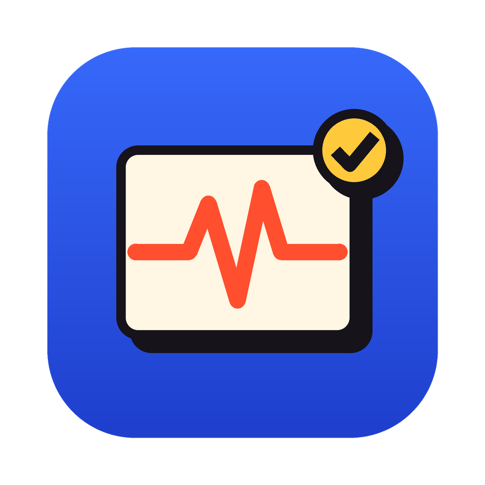

# Kavosh Diagnostics

A hardware check-up and benchmark app for **macOS** and **Windows**, with a bold
"retro" look and a full English / Persian (فارسی) interface. The macOS app is native
Swift/SwiftUI; the Windows app (in [`windows/`](windows/)) is C#/.NET 8 with Avalonia and
runs the exact same CPU workload, GPU scene, scoring and CSV format, so scores from both
can be compared.



## What it does

**Dashboard**
- System specs: model name, chip and core layout (e.g. `14C (10P+4E)`), GPU cores and Metal version, memory type, display resolution and refresh rate, drives, macOS and firmware.
- Live telemetry (last 90 seconds): CPU load with per-core bars, memory load and pressure, GPU load, CPU and GPU temperature, system power, fan speed, thermal state.
- Drive health read straight from each SSD's own NVMe SMART log: life left, spare blocks, TB written, power-on hours, media errors and warnings.

**Test suite** (run everything, performance only, or any single test)

| Station | What it measures |
|---|---|
| CPU benchmark | Multi-core and single-core scores, then a sustained load to detect thermal throttling. Every result is checked against known answers, so an unstable CPU is caught. |
| GPU render test | Off-screen Metal raymarch of a fractal at 2560×1440 with 2×2 supersampling, with a live preview. Score, fps, 1% lows, sustained score. |
| Memory test | Writes six patterns into up to 2 GB of RAM, reads them back and counts bit errors, plus read/write throughput. |
| Battery health | Design vs. full-charge capacity, cycles, condition, and discharge watts under a short load. |
| Display check | Full-screen color slides, gradients, a measured refresh-rate test and a defect checklist. |
| Speaker check | Left / right test tones and a synthesized music track that ramps up in volume. |
| Mic & camera | Live webcam preview, microphone level meter and pitch detection. |
| Keyboard & trackpad | Type a sentence, press every key on an on-screen Mac keyboard (detects dead and double-registering keys), then move, click and scroll. |
| Drive health | SMART / NVMe health of every physical drive. |

At the end you get a **health grade (A+ to F)** based only on the hardware checks
(CPU/GPU speed never affects it), a breakdown of every issue, and a **CSV export**.
Unfinished runs can be resumed later.

**SSD speed test**: CrystalDiskMark-style SEQ1M Q8T1, RND4K Q32T1 and RND4K Q1T1
read/write with a 1 GiB file, uncached I/O and best-of-5 runs (or a quick mode).

**Screen Washer & burn-in fixer**: full-screen noise / RGBW / gradient patterns for
5, 15, 30 minutes or until stopped, plus uniformity slides to inspect the panel. Has a
photosensitivity warning and keeps the Mac awake while running.

## Download

Every push to `main` is built on GitHub's macOS and Windows runners and published on the
[Releases page](../../releases/latest).

**macOS** — `Kavosh-Diagnostics-macOS.zip`: unzip it and drag **Kavosh Diagnostics** into
Applications.

The app isn't notarized by Apple, so the first time you open it macOS blocks it. Open
**System Settings → Privacy & Security** and click **Open Anyway**, or run once:

```bash
xattr -dr com.apple.quarantine "/Applications/Kavosh Diagnostics.app"
```

**Windows 10 / 11** — `Kavosh-Diagnostics-Windows-x64.zip` (or `-ARM64` for Snapdragon
laptops): unzip and run **Kavosh.exe**. It's a single portable file, nothing to install.

- The exe isn't code-signed, so SmartScreen may show *"Windows protected your PC"*: click
  **More info → Run anyway**.
- Windows asks for administrator rights at start-up; that's what lets the app read drive
  health (SMART) and CPU sensors.
- CPU temperature, power and fan readings also need the free, signed
  [PawnIO](https://pawnio.eu) driver (used by LibreHardwareMonitor). Kavosh never installs
  drivers itself; if it's missing the header shows **Limited sensors** with a link, and
  everything else still works.

## Windows version

What's different from the Mac app:

| | macOS | Windows |
|---|---|---|
| UI | SwiftUI | Avalonia (C#, .NET 8), same retro design, light/dark, English/فارسی |
| GPU test | Metal | Direct3D 11 (same raymarch scene, HLSL port of the shader) |
| Sensors | AppleSMC | LibreHardwareMonitor (+ PawnIO), Windows performance counters |
| Drive health | NVMe log via IOKit | NVMe log via the Windows storage driver, ATA SMART for SATA drives, Windows reliability counters |
| Battery | IOKit (mAh) | Windows battery driver (mWh) |
| Refresh rate | CADisplayLink | timed against the monitor's real vertical blanks (DXGI) |
| Keyboard test | Mac layout | PC laptop layout (physical keys, so any keyboard language works) |
| Camera / mic | AVFoundation | DirectShow (FlashCap) / WASAPI (NAudio) |

Build it on Windows with the .NET 8 SDK:

```powershell
cd windows
dotnet test tests/Kavosh.Core.Tests        # unit tests (also run on Linux/macOS)
./build.ps1                                # dist/win-x64/Kavosh.exe and the zips
dotnet run --project src/Kavosh.App        # run from source
```

Command-line mode works the same way: `Kavosh.exe --dump`, `--cpu [--quick]`,
`--memory`, `--gpu`, `--ssd D:\ --quick`. `Kavosh.exe --screenshots <folder>` renders
every screen off-screen with sample data. Results and settings are saved in
`%APPDATA%\Kavosh Diagnostics\`.

## Requirements

- macOS 14 Sonoma or newer (Apple silicon or Intel)
- Xcode 15.3 or newer (or the Command Line Tools for a single-architecture build)

## Build and run

```bash
# Build the app into dist/Kavosh Diagnostics.app (and dist/Kavosh-Diagnostics-macOS.zip)
./Scripts/build-app.sh

# Build and open it
./Scripts/build-app.sh --open

# One app for both Apple silicon and Intel (needs full Xcode)
./Scripts/build-app.sh --universal
```

Or with `make`: `make app`, `make run`, `make test`, `make dump`.

You can also open `Package.swift` in Xcode and press Run.

The first time you open the app from the `dist` folder macOS may ask for permission to
use the camera and microphone during the Mic & Camera test. The app is signed "ad hoc"
(no Apple developer account needed), so after each rebuild macOS may ask again.

### Command-line mode

Handy for checking that every sensor reads correctly, without the UI:

```bash
"dist/Kavosh Diagnostics.app/Contents/MacOS/KavoshDiagnostics" --dump
"dist/Kavosh Diagnostics.app/Contents/MacOS/KavoshDiagnostics" --cpu --duration 60
"dist/Kavosh Diagnostics.app/Contents/MacOS/KavoshDiagnostics" --memory
"dist/Kavosh Diagnostics.app/Contents/MacOS/KavoshDiagnostics" --gpu --duration 30
"dist/Kavosh Diagnostics.app/Contents/MacOS/KavoshDiagnostics" --ssd ~/Desktop --quick
```

### Continuous integration

`.github/workflows/build.yml` builds the universal Mac app on a GitHub macOS runner and
the Windows exe (x64 and ARM64) on a Windows runner, runs the unit tests and quick
hardware smoke tests on both, uploads the zips as artifacts, and on pushes to `main`
publishes both in one GitHub Release.

## Project layout

```
Package.swift
Sources/
  KavoshSensors/        C: AppleSMC sensors, NVMe SMART log, drive list (IOKit)
  KavoshCore/           Engines and models, mostly plain Foundation
    CPUBenchmark.swift    verified CPU workload + multi/single/sustained engine
    MemoryTest.swift      pattern write/verify memory test
    StorageBenchmark.swift CrystalDiskMark-style SSD test
    Scoring.swift         health components, grade, battery penalty
    DriveHealth.swift     NVMe SMART parsing and evaluation
    AudioAnalysis.swift   level meter and pitch detection
    Keyboard.swift        Mac keyboard layout, key-press tracker
    Persistence.swift     settings, saved results, CSV export
    Mac/                  sysctl, IOKit, SMC, battery, telemetry readers
  KavoshDiagnostics/    The SwiftUI app
    App/ Dashboard/ Suite/ Stations/ GPU/ Audio/ Storage/ Washer/ Results/ Design/
Tests/KavoshCoreTests/  Unit tests (also run on Linux)
Resources/              Info.plist, app icon, Vazirmatn font (OFL)
Scripts/build-app.sh    Builds, bundles, signs and zips the .app
```

Results and settings are saved in `~/Library/Application Support/Kavosh Diagnostics/`
(`results.csv` keeps one row per completed run).

## Notes

- **Scores.** CPU and GPU scores are relative to a reference machine (Apple M1 = 1,000
  multi-core, 100 single-core, 1,000 GPU). The reference timings are estimates, so treat
  the numbers as Kavosh's own scale rather than comparable to Geekbench or Cinebench.
  Change `referenceUnitMsSingle` in `CPUBenchmark.swift` and `referenceFrameMs` in
  `GPUBenchmark.swift` to recalibrate once you've run it on a known Mac.
- **Sensors.** Temperature, fan and power keys differ between Mac generations. The app
  enumerates the SMC keys at launch and keeps the CPU/GPU temperature keys that return
  sensible values. If a reading shows "—", run `--dump` and look at the `smc` line.
- **Not included**: online accounts, points and leaderboards, and running third-party
  benchmarks (Geekbench / Cinebench) from inside the app.
- **Renaming.** The app name lives in `Resources/Info.plist`, `Scripts/build-app.sh`
  (`APP_NAME`) and `AppPaths.folderName`.

## License notes

The Vazirmatn font in `Resources/Fonts` is © The Vazirmatn Project Authors, under the
SIL Open Font License 1.1 (see `Resources/Fonts/OFL.txt`). The Windows app also uses the
Nunito font (OFL) and several open-source libraries; see
[`windows/THIRD-PARTY-NOTICES.txt`](windows/THIRD-PARTY-NOTICES.txt).
